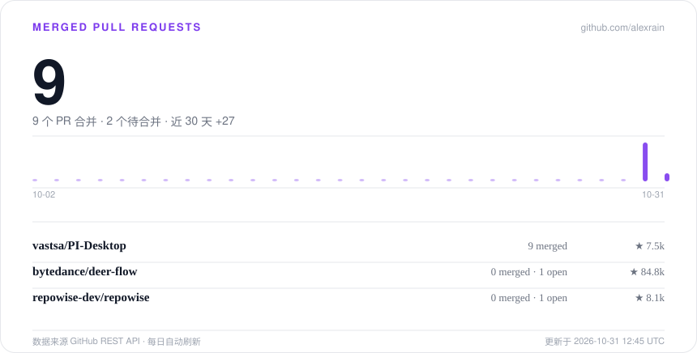

# ALEXXU

构建 Coding Agent，持续向 deer-flow、PI-Desktop、repowise 等 AI 开源仓库贡献代码。

研究生在读 · Agent Harness / MCP / 多智能体系统 · 南京 / 苏州 / 杭州 / 上海

## 重点仓库

[deer-flow](https://github.com/bytedance/deer-flow) · [PI-Desktop](https://github.com/vastsa/PI-Desktop) · [repowise](https://github.com/repowise-dev/repowise)

  数据来源 GitHub REST API · 每日自动刷新

